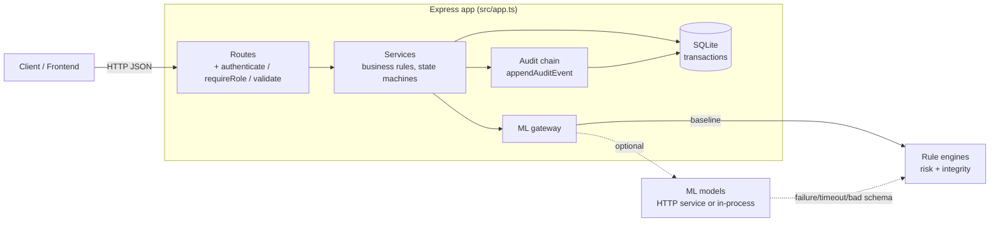
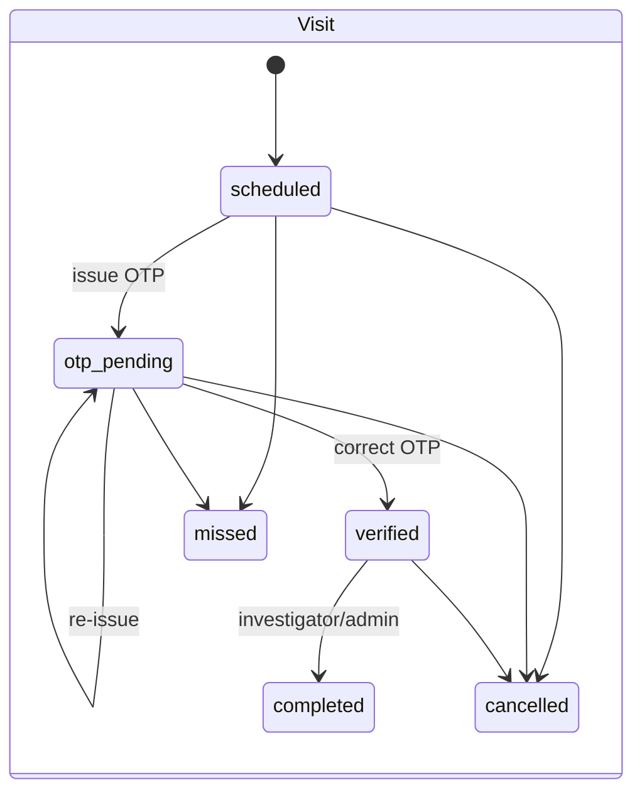
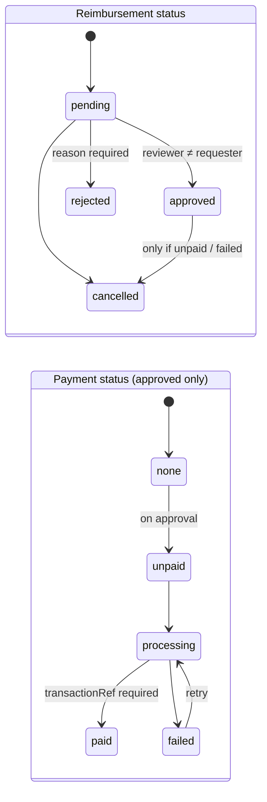
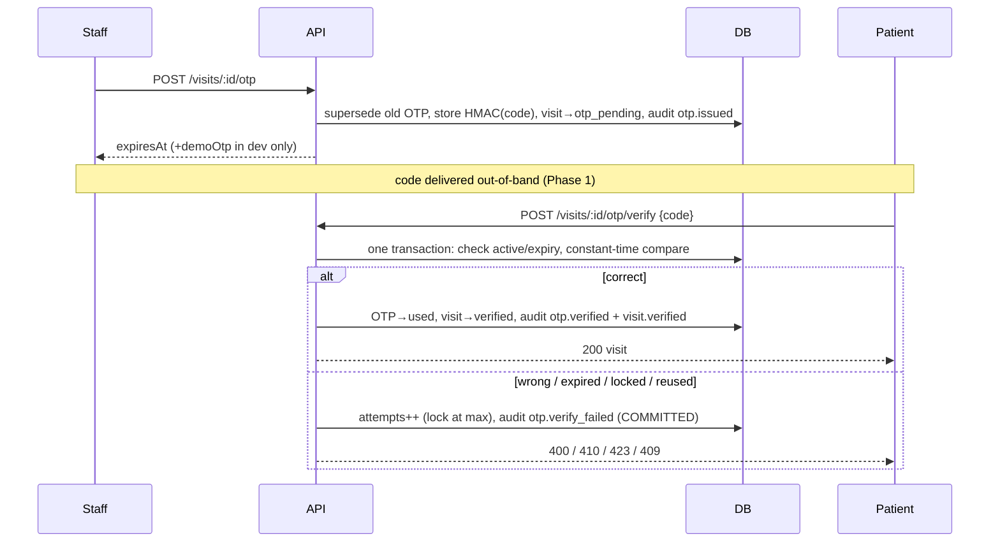
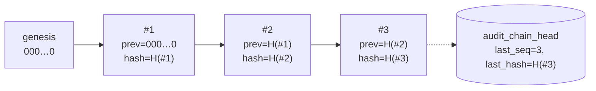
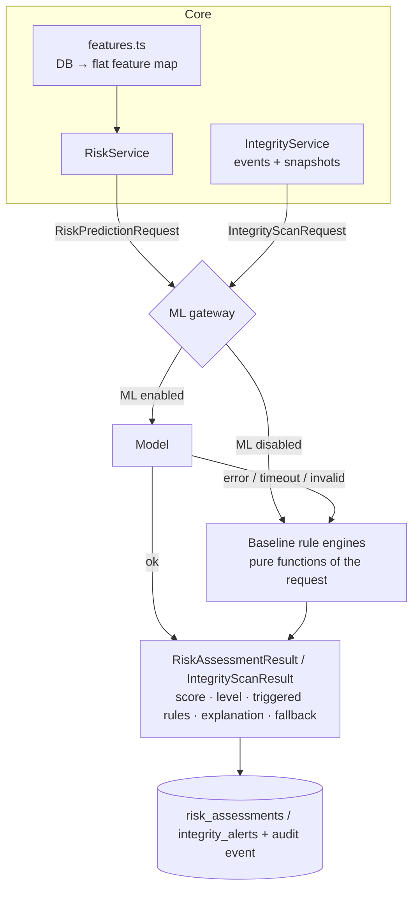

# Architecture overview

## Technology choices

| Choice | Why |
|---|---|
| **TypeScript (strict)** | Strong typing across services, schemas and the ML contract. |
| **Express 4** | Mature, minimal, easy for a frontend/ML team to reason about. Thin routes, no framework magic. |
| **SQLite (`better-sqlite3`)** | A real relational DB (FKs, CHECKs, partial unique indexes, triggers, JSON functions) with zero setup — `npm install && npm run migrate` just works. Its **synchronous, single-writer transactions** make "business change + audit event commit atomically and in order" trivial and testable. |
| **Plain SQL + small helpers** | "No unnecessary abstractions": no ORM; queries are explicit and reviewed. Migrations are ordered `.sql` files. |
| **Zod** | One schema per request is the single source for validation, TypeScript types **and** OpenAPI docs. |
| **JWT + bcrypt** | Stateless auth with immediate revocation (user re-loaded per request). |
| **Vitest + Supertest** | Fast, in-memory integration tests against the real app. |

## Layering



- **Routes** (`modules/*/routes.ts`) do HTTP only: authn/authz middleware, validation, call a service, shape the response. No business logic.
- **Services** (`modules/*/service.ts`) own business rules. Each mutating operation is `inTransaction(db, …)` and appends its audit event inside that same transaction. Services depend only on a `Ctx` (`db`, `config`, `logger`, `ml`) — easy to test and to call from the seed script.
- **Schemas** (`modules/*/schemas.ts`) hold zod request schemas.
- **Cross-cutting**: central error handler (`AppError` → JSON envelope, unknown errors → 500 without leaking internals), request ids, structured redacting logs.

### Response envelope

```jsonc
// success                     // list                                 // error
{ "success": true,             { "success": true,                      { "success": false,
  "data": { … } }                "data": [ … ],                          "error": { "code": "OTP_INVALID",
                                 "meta": { "page":1,"pageSize":20,                  "message": "…",
                                           "total":57,"totalPages":3 } }            "details": { … },
                                                                                    "requestId": "…" } }
```

Status codes: 200/201 success · 400 validation (and `OTP_INVALID`) · 401 unauthenticated · 403 forbidden · 404 not found · 409 conflict / invalid state transition / `OTP_NOT_ACTIVE` · 410 `OTP_EXPIRED` · 413 payload too large · 423 `OTP_LOCKED` · 429 rate limited · 500 unexpected.

## Domain state machines

All transitions are declared in one map per entity (`utils/stateMachine.ts`) and rejected with `409 INVALID_STATE_TRANSITION`.





Other machines: **Trial** `draft→active→suspended↔active→completed|terminated`; **Enrollment** `screening→enrolled|screen_failed|withdrawn`, `enrolled→completed|withdrawn`; **Action** `pending↔in_progress→completed(→in_progress)|cancelled`; **Integrity alert** `open→acknowledged→resolved|dismissed`, resolved/dismissed can reopen. "Overdue" for actions is derived (`open && dueDate < now`), never stored, so it can't go stale.

## OTP flow



Failure outcomes are returned from the transaction and thrown **after commit**, so attempt counters, lockouts and audit events are never rolled back by the error.

## Tamper-evident audit chain



`hash = SHA-256(canonicalJSON{v, seq, id, actorId, action, entityType, entityId, metadata, createdAt, prevHash})` — canonical JSON sorts keys, so the hash is independent of key order.

**Append** (`appendAuditEvent`): inside the caller's `BEGIN IMMEDIATE` transaction, read the head row, compute `seq+1`/`prevHash`/`hash`, insert the event, update the head. SQLite allows one writer at a time, and `IMMEDIATE` takes the write lock up front, so concurrent writers (even from separate connections/processes sharing the file) serialize and can never fork the chain. If the business transaction rolls back, the event rolls back with it.

**Verify** (`verifyChain`) walks every event in `seq` order and checks: contiguous `seq` (deletions/insertions), `prev_hash` equals predecessor's hash, recomputed hash equals stored hash (modification), and the head pointer matches the last row (tail truncation / wipe). Errors are typed: `sequence_gap`, `prev_hash_mismatch`, `hash_mismatch`, `head_mismatch`, `invalid_record`.

| Attack (attacker has DB write access) | Detected? |
|---|---|
| Edit any field of an event | ✅ `hash_mismatch` |
| Edit an event **and** recompute its hash | ✅ successor's `prev_hash_mismatch` |
| Delete an event in the middle / first event | ✅ `sequence_gap` + `prev_hash_mismatch` |
| Delete trailing events | ✅ `head_mismatch` |
| Insert a forged event | ✅ `hash_mismatch`/`head_mismatch` |
| **Rewrite the entire chain from some point and update the head** | ❌ not detectable from the DB alone — mitigate by periodically exporting `headHash` (returned by `/audit/verify`) to a separate system (WORM storage, another service, a ticket). |

Defense in depth: SQLite triggers reject `UPDATE`/`DELETE` on `audit_logs` (an attacker must first drop them, which tests demonstrate is still detected). Failed verifications append `audit.chain_verification_failed` and log at error level; the integrity engine raises a *critical* `integrity.chain_broken` alert. Audit metadata excludes OTPs, passwords and direct patient identifiers.

## Risk & integrity engines



- **Risk**: `score = min(100, Σ weight of triggered rules)`; level thresholds (25/50/75) and every rule's `enabled/weight/threshold` are configurable via `RISK_RULES_OVERRIDES`.
- **Integrity**: rules over audit events and record snapshots (duplicate claims, OTP guessing, fail-fail-success sequences, self-approval, churn, amount-edit-before-approval, unverified overdue visits, role changes, login bursts, broken chain). Findings are **de-duplicated by fingerprint** so repeated scans don't spam alerts.
- Engines are **pure with respect to their request object** and are swapped behind `RiskEngine` / `IntegrityEngine` interfaces (`src/ml/contracts.ts`). Nothing outside `src/ml` knows whether ML is on.

## Security summary

bcrypt passwords · HS256 JWT with DB re-check · RBAC in middleware + service-level ownership checks · server-side patient scoping · zod validation on every input incl. sort/filter whitelists (no SQL string interpolation of user input) · parameterised SQL · helmet · CORS allow-list · body size cap · auth rate limiting · constant-time OTP compare, keyed OTP hashing, attempt limits · secrets only from env, startup validation, redacting logs · generic login errors with timing equalisation · unexpected errors never leak internals.
