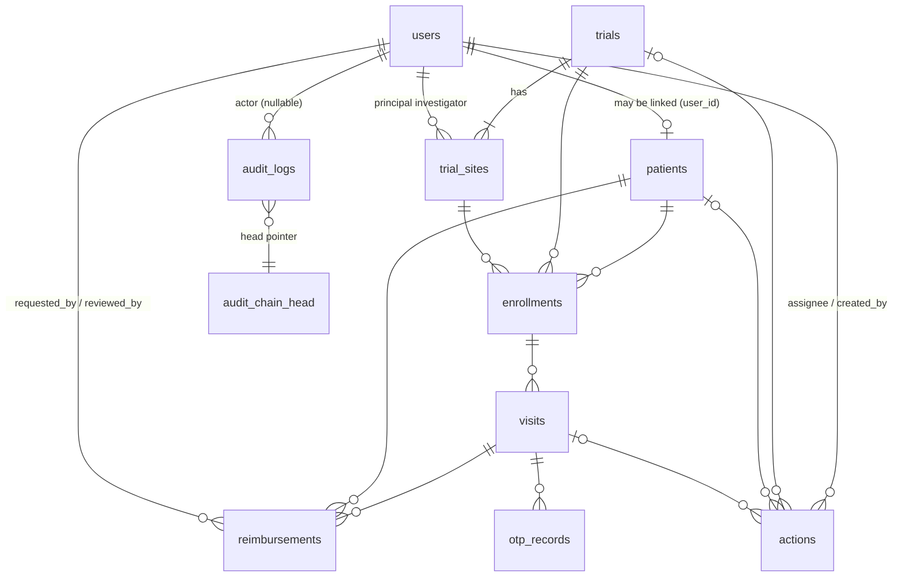

# Database schema

SQLite, created by [`src/db/migrations/001_init.sql`](../src/db/migrations/001_init.sql) (the migration runner records applied files in `schema_migrations`). Conventions: UUID text primary keys; ISO-8601 UTC timestamps (`created_at`, `updated_at` on every mutable table); `PRAGMA foreign_keys=ON`; enums enforced with `CHECK`; booleans as 0/1 (exposed as `is…` booleans); JSON stored as text.

`risk_assessments`, `integrity_alerts`, `audit_logs` and `status_history` reference entities by (`entity_type`, `entity_id`) rather than FK, so they can describe any entity and survive soft deletes.

## Tables

| Table | Purpose | Key constraints / indexes |
|---|---|---|
| `users` | Accounts + role (`admin`/`coordinator`/`investigator`/`patient`), `is_active`, bcrypt `password_hash` | `email` UNIQUE NOCASE; index on `role` |
| `patients` | Pseudonymous `subject_code`, demographics, optional `user_id` link, `status`, soft delete (`deleted_at`) | `subject_code` UNIQUE; `user_id` UNIQUE FK→users; index on (last,first), `status` |
| `trials` | `code`, title, sponsor, `phase` (I…IV), `status`, dates, soft delete | `code` UNIQUE; CHECK `end_date >= start_date` |
| `trial_sites` | Sites belonging to a trial, optional PI (investigator user) | UNIQUE (`trial_id`,`site_code`); FK cascade from trial |
| `enrollments` | Patient↔trial↔site, `status`, `arm`, `enrolled_at`/`ended_at` | UNIQUE (`patient_id`,`trial_id`); indexes on trial/status, site |
| `visits` | Scheduled visit with lifecycle timestamps (`otp_issued_at`, `verified_at`, `verified_by`, `completed_at`); denormalised `patient_id`/`trial_id`/`trial_site_id` for fast queries | indexes (patient,scheduled), (trial,status), (status,scheduled) |
| `otp_records` | **Hash only** (`code_hash` = HMAC-SHA256), `status` (`active/used/expired/locked/superseded`), `attempts`, `max_attempts`, `expires_at`, `used_at` | **partial UNIQUE (`visit_id`) WHERE status='active'** → one active OTP per visit |
| `audit_logs` | Append-only hash chain: `seq`, `id`, `actor_id`, `action`, `entity_type`, `entity_id`, canonical-JSON `metadata`, `created_at`, `prev_hash`, `hash` | `seq` PK; `id`,`hash` UNIQUE; **triggers block UPDATE/DELETE**; indexes on entity, actor, action |
| `audit_chain_head` | Single row (`id=1`) with `last_seq`, `last_hash` | CHECK `id = 1` |
| `reimbursements` | Amount (`amount_cents` > 0, `currency`), `category`, `status`, `payment_status`, requester/reviewer, `rejection_reason`, `paid_at`, `transaction_ref` | indexes on patient, visit, (status,payment_status) |
| `status_history` | Generic transition log for `reimbursement` and `action` (`field` = `status` or `payment_status`) | index (entity_type, entity_id, created_at) |
| `actions` | Tasks: `status`, `priority`, `due_date`, `assignee_id`, optional `trial_id`/`patient_id`/`visit_id`, `completed_at` | indexes on (assignee,status), due_date, trial |
| `risk_assessments` | Persisted engine output: `score` 0–100, `level`, `triggered_rules` (JSON), `explanation`, `engine_name/version`, `fallback_used/reason` | indexes (entity), level |
| `integrity_alerts` | Alert with `rule_id`, `severity`, `status`, `details` (JSON), `source` engine, resolution fields | `fingerprint` UNIQUE (de-duplication); indexes (status,severity), entity |

## Design notes

- **Integrity at the DB level**: FKs, CHECK enums, positive amounts, date ordering, unique enrollments, one active OTP per visit, append-only audit triggers.
- **Extensibility**: add new modules with a new numbered migration file; entity-typed tables (`audit_logs`, `status_history`, `risk_assessments`, `integrity_alerts`) accept new entity types without schema change (risk assessments have a CHECK listing supported types — extend it in a migration when adding one).
- **Soft deletes** for patients/trials (clinical records must not vanish); deletion is refused when enrollments exist.
- **PII**: names/DOB/contact live only in `patients` (and `users.email/full_name`); audit metadata uses ids and subject codes.
